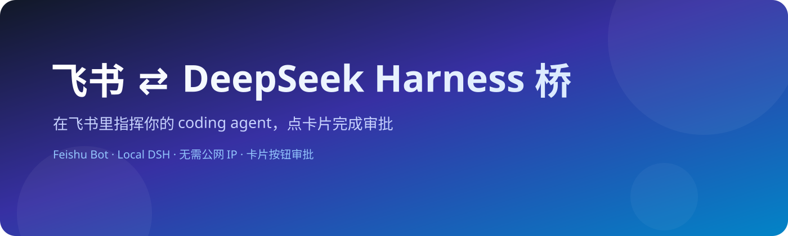

<div align="center">



# Feishu ⇄ DeepSeek Harness Bridge

[简体中文](README.md) · **English**

<br />


**Use your local DeepSeek Harness from Feishu like a chat bot**: send instructions, watch it work, and **approve actions with card buttons**.
No public IP, no reverse proxy — the host dials out to Feishu over a long-lived WebSocket.

</div>

---

## ✨ Features

| Feature | Description |
|---|---|
| 💬 Chat in / out | Send text to the bot in Feishu; it becomes a prompt to a DSH session |
| 👀 Live relay | Assistant replies and tool calls are streamed back to Feishu |
| ✅ Card approvals | Pending approvals arrive as a card with **Allow / Reject** buttons |
| ❓ Questions | Single-choice questions are rendered as option cards |
| 🧵 Sessions | Each Feishu chat maps to its own persistent DSH session |
| 🖥 Multi-machine | One bridge per machine; mention the bot you want in a shared group |
| 🛡 Fail-closed | Startup self-check, auto-reconnect, approvals time out as *cancelled* |

## 🧩 How it works

```
Feishu App (mobile / desktop)
      ▲  long-lived WebSocket (outbound, no public IP)
      │
Host: node bridge ── stdio JSON-RPC ──► dsh --profile sdk (the actual agent)
      │                                    │
      └──── assistant / tool events ◄──────┘
      └──── approval card buttons ◄── approval/request
```

Approvals use the native DSH SDK protocol: initialize with `approvalRequests: true`, the runtime forwards `approval/request` to the client, and replying `allowed-once` / `rejected` completes the decision.

## 🚀 Quick start

### 0. Requirements

- Windows with **Node.js ≥ 18**
- **DeepSeek Harness** installed (the bridge launches the local agent)
- A Feishu account registered with a **phone number** (Doubao accounts are blocked by platform policy)

### 1. Create a Feishu app (one per machine)

1. Open the [Developer Console](https://open.feishu.cn/app) → **Create custom app**
2. **App capabilities → Bot → Add**
3. **Permissions** — enable `im:message`, `im:message:send_as_bot` (plus `im:chat`, `im:resource`, `im:message.group_msg.include_bot:read` optionally)
4. **Events & Callbacks**
   - Event subscription mode: **long connection**; add event `im.message.receive_v1`
   - Callback subscription mode: **long connection**; add callback `card.action.trigger`
5. **Version management** → create a version (availability = yourself) → publish → approve in Admin Console
6. **Credentials & basic info** → copy **App ID / App Secret**

> ⚠️ One App ID can only run on one machine at a time (Feishu load-balances events across connections). Use two apps for two machines.

### 2. Configure

```powershell
copy config.example.json config.json
```

Fill in `feishu.appId` / `appSecret`, `dsh.dshHome`, `dsh.cwd`, `dsh.runtimeExe` and the model name. `config.json` is git-ignored.

### 3. Run

```powershell
cd dsh-feishu
npm install --no-audit --no-fund --ignore-scripts
powershell -NoProfile -ExecutionPolicy Bypass -File .\run.ps1
```

Wait for `飞书长连接已建立` (long connection established), then find the bot in Feishu and send a message.

## 🧪 Try it without DSH (mock mode)

Set `"mockMode": true` in `config.json`. The bot replies with a mock message and sends an approval card — perfect for verifying your Feishu app configuration (long connection, events, callback, permissions, publish) before wiring the real agent.

## 🛠 Scripts

| Command | Purpose |
|---|---|
| `powershell -File .\run.ps1` | Start the bridge |
| `powershell -File .\stop.ps1` | Stop the bridge |
| `powershell -File .\install-autostart.ps1` | Register logon autostart |
| `powershell -File .\install-autostart.ps1 -Uninstall` | Remove autostart |
| `node test\selftest.js` | Self-test (expects `SELFTEST PASS`) |

## 🔐 Security

- The bot credentials equal control of that machine — keep them to yourself.
- Narrow access with `dmMode: "allowlist"` + `dmAllowlist`; restrict approvers with `approvalAllowlist`.
- Approvals time out after 30 minutes as *cancelled*; nothing is executed silently.

## ❓ Troubleshooting

| Symptom | Fix |
|---|---|
| `DNS … failed` in the log | Check proxy/network; ensure `open.feishu.cn` resolves |
| `21001 Access denied due to platform policy` | Recreate the app under a phone-registered account |
| Bot never replies | Check `logs/bridge.log`; verify long-connection events, `im.message.receive_v1`, app published |
| Approval buttons do nothing | Add the `card.action.trigger` callback |
| `SEC_E_NO_CREDENTIALS` on git push | `git config --local http.sslBackend openssl` |

## 📌 Known limitations

- Text only; images/files are not relayed yet
- Multiple questions in one request are not supported
- Approval times out after 30 minutes

## License

[MIT](LICENSE)
