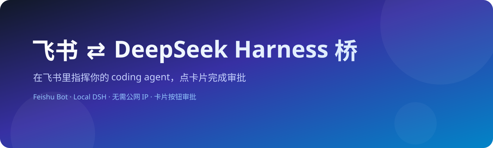

<div align="center">



# 飞书 ⇄ DeepSeek Harness 桥

<br />


**在飞书里像聊天一样使用本机的 DeepSeek Harness**：发指令、看它执行、**点卡片按钮完成审批**。
不需要公网 IP、不需要反向代理——本机主动用飞书长连接连出去即可。

</div>

---

## ✨ 功能特性

| 🧩 能力 | 说明 |
|---|---|
| 💬 收发指令 | 飞书里给机器人发文字，自动作为指令交给 DSH 会话 |
| 👀 实时回传 | DSH 的助手回复、工具调用，实时转发回飞书 |
| ✅ 卡片审批 | 需要授权时弹出「允许 / 拒绝」按钮卡片，点一下完成 |
| ❓ 卡片问答 | DSH 需要确认时，飞书弹出选项卡片（单题单选） |
| 🧵 多会话 | 每个飞书聊天对应一个独立 DSH 会话，长期续聊 |
| 🖥 多机支持 | 每台电脑各跑一套，群里 `@机器人` 即切换目标 |
| 🛡 安全兜底 | 启动自检、长连接自动重连、审批超时按取消处理（fail-closed） |

## 🧩 工作原理

```
飞书 App（手机 / 电脑）
      ▲  长连接（出站，免公网 IP）
      │
本机：node 桥程序 ── stdio JSON-RPC ──► dsh --profile sdk（真正干活的 agent）
      │                                      │
      └──── 助手回复 / 工具动作 ◄─────────────┘
      └──── 审批卡片按钮 ◄── approval/request
```

审批走的是 DSH SDK 协议原生的 `approval/request`：初始化时声明 `approvalRequests: true`，服务端把审批原样抛给客户端，客户端返回 `allowed-once` / `rejected` 即完成授权，全程无需写额外适配层。

## 🚀 快速开始

### 0. 环境要求

- Windows，已装 **Node.js ≥ 18**
- 已装 **DeepSeek Harness**（桥通过它启动本机 agent）
- 一个手机号注册的**飞书账号**（豆包账号会被平台策略限制，见排错）

### 1. 建飞书应用（每台电脑一个）

1. 打开 [开发者后台](https://open.feishu.cn/app) → **创建企业自建应用**
2. 左侧 **应用能力 → 机器人 → 添加**
3. 左侧 **权限管理**，开通：
   - `im:message`
   - `im:message:send_as_bot`
   - `im:chat`、`im:resource`、`im:message.group_msg.include_bot:read`（可选）
4. 左侧 **事件与回调**：
   - 事件配置：订阅方式 **使用长连接接收事件** → 添加事件 `im.message.receive_v1`
   - 回调配置：订阅方式 **使用长连接** → 添加回调 `card.action.trigger`
5. **版本管理与发布** → 创建版本（可用范围选自己）→ 申请发布 → 管理后台通过
6. **凭证与基础信息** → 复制 **App ID / App Secret**

> ⚠️ 一个 App ID 同一时间只能在一台电脑上跑（长连接是多连接抢同一条事件）。控两台就建两个应用。

### 2. 配置

```powershell
copy config.example.json config.json
```

至少填写：

| 字段 | 说明 |
|---|---|
| `feishu.appId` / `appSecret` | 飞书应用凭证 |
| `dsh.dshHome` | DSH 数据目录，如 `C:\Users\<用户名>\.dsh`（复用你的 DeepSeek 登录） |
| `dsh.cwd` | agent 的工作目录 |
| `dsh.runtimeExe` | `DeepSeek Harness.exe` 的路径 |
| `dsh.model` / `modelCandidates` | 模型名；可填多个，桥会依次尝试直到初始化成功 |

> `config.json` 已被 `.gitignore` 忽略，**不会提交**。

### 3. 启动

```powershell
cd dsh-feishu
npm install --no-audit --no-fund --ignore-scripts
powershell -NoProfile -ExecutionPolicy Bypass -File .\run.ps1
```

看到：

```text
[info] 飞书长连接已建立，机器人：DSH-公司
[info] 就绪：在飞书里给机器人发消息即可
```

在飞书里搜机器人名字 → 单聊 → 发消息即可。

## 🧪 先不接真 DSH（mock 验证）

`config.json` 里设 `"mockMode": true` 再启动，发消息会收到「模拟回复」并弹审批卡片。
**用它先把飞书后台配得对不对（长连接、事件、回调、权限、发布）验证掉**，通过后再改回 `false` 接真 DSH，省得来回排查。

## 📁 目录结构

```text
src/index.js          主程序：飞书收发 + 会话映射 + 审批/问答卡片
src/dsh.js            DSH SDK JSON-RPC 客户端（stdio，按换行分帧）
src/cards.js          飞书卡片 JSON（审批卡、结果卡、询问卡）
src/config.js         读取 config.json，推导 bin.js 路径
test/selftest.js      自测：不起真模型，验证传输/通知/审批往返
test/mock-dsh.js      假 DSH 服务端（mock 模式使用）
run.ps1               启动桥
stop.ps1              停止桥
install-autostart.ps1 注册 / 卸载「登录时自启」计划任务
config.example.json   配置模板（公司电脑用）
config.home.example.json 配置模板（家里电脑用）
docs/banner.svg       README 横幅图
```

## 🛠 常用命令

| 命令 | 作用 |
|---|---|
| `powershell -File .\run.ps1` | 前台启动桥 |
| `powershell -File .\stop.ps1` | 停止桥 |
| `powershell -File .\install-autostart.ps1` | 注册登录自启 |
| `powershell -File .\install-autostart.ps1 -Uninstall` | 卸载自启 |
| `node test\selftest.js` | 跑自测（期望 `SELFTEST PASS`） |

## 💬 发给机器人的指令

| 发送 | 作用 |
|---|---|
| 任意文字 | 交给 DSH 处理（同一聊天持续同一会话） |
| `/new` / `重置` / `新会话` | 开新会话 |
| `/permission <preset>` | 切换权限预设 |
| `/compact` | 压缩历史 |

## 🖥 多台电脑（家里 + 公司）

<details>
<summary>展开查看</summary>

1. 两台电脑各建一个飞书应用（机器人名 `DSH-家里` / `DSH-公司`），各拿一对 App ID / Secret。
2. 两台电脑各跑一套桥，`config.json` 里的 `dshHome`、`cwd`、`stateFile`、`logDir` 指向各自路径。
3. 飞书里建一个群，把两个机器人都拉进去。
4. 在群里 `@DSH-家里` 或 `@DSH-公司` 即可，审批卡片各发各的。

</details>

> 想做到「一个机器人用前缀切换目标」（`家里: …` / `公司: …`）需要一个中枢进程同时连到两台机器，前提是两台之间网络可达（Tailscale / 公司 VPN / 小服务器）。本版未实现。

## 🔐 安全提醒

- 机器人凭证等于**这台机器的控制权**，只发给你自己。
- 收窄访问：`feishu.dmMode: "allowlist"` + `dmAllowlist`；审批权限用 `approvalAllowlist` 填你的 open_id。
- 撤销全部会话：删除 `%USERPROFILE%\.dsh\.credentials.yaml` 里 `client-connection/browser-session` 记录并重启。
- 审批 30 分钟无人处理按取消，操作不会被静默执行。

## ❓ 常见问题

| 现象 | 处理 |
|---|---|
| 日志 `网络自检：DNS 解析 … 失败` | 检查代理/网络，确认能解析 `open.feishu.cn` |
| `21001 Access denied due to platform policy` | 豆包账号被平台策略限制，改用手机号注册的账号重建应用 |
| 发消息机器人不回 | 看 `logs/bridge.log`；确认事件订阅=长连接、加了 `im.message.receive_v1`、应用已发布 |
| 审批卡片点了没反应 | 后台「事件与回调」里确认加了回调 `card.action.trigger` |
| 群里机器人不回 | 默认要 @机器人；或把 `feishu.requireMention` 设 `false` |
| 回复太长被截断 | 调大 `bridge.maxReplyChars` |
| push 报 `SEC_E_NO_CREDENTIALS` | 执行 `git config --local http.sslBackend openssl` |

## 📌 已知限制

- 只转发文字，图片 / 文件双向暂不支持
- 一次问多个问题暂不支持，会提示在电脑端处理
- 审批 30 分钟无人处理按取消（操作不会执行）

---

<div align="center">

**用一个飞书群，就能同时指挥家里的和公司的两台 DSH。** 🤖

</div>
